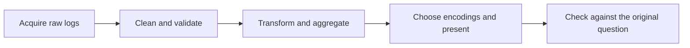

# Assignment 01 - Visual perception and visualization design

**Subject:** Data and Information Visualization. **ERP source:** MCA209D-AS01.pdf. The PDF prints MCA207D; the ERP filename uses MCA209D. This mismatch is retained in the source mapping rather than silently corrected. All five questions are answered below.

## Q1. Preattentive attributes and Gestalt principles

Preattentive attributes are visual properties that can be noticed rapidly before a viewer deliberately reads every mark. Their effectiveness depends on context, contrast and task; adding many competing highlights removes the advantage.

| Attribute | Example | Design application |
|---|---|---|
| Colour contrast | One orange failed server among grey healthy servers | Reserve the accent for an actionable exception; add a label or symbol so colour is not the only signal. |
| Size | A large incident marker among smaller ones | Encode impact with marker **area**, not radius, and provide a size legend. |
| Orientation | A diagonal mark in a field of vertical marks | Use an unusual orientation sparingly to flag a change or anomaly. |

Gestalt principles explain how people organize separate visual elements into perceived groups. **Proximity:** place a chart title and its legend close to that chart, with more whitespace between unrelated panels. A viewer then associates the correct explanation with the correct plot. **Similarity:** use the same colour and marker for the same service across dashboard panels; the repeated appearance implies membership. **Continuity:** connected, ordered points in a time series help viewers trace a trend. Do not connect unrelated categories because that suggests a continuous relationship. **Enclosure:** a subtle border or background can group related metrics, but heavy boxes around every item create clutter.

For a failure dashboard, combine proximity to group each service's metrics with one consistent warning colour. A viewer can locate a problem first, then read exact values. Use accessible contrast, direct labels and a restrained palette to support both scanning and careful interpretation.

## Q2. The visualization pipeline

Consider an illustrative server log with request ID, timestamp, service, status and response time.

1. **Acquisition:** collect logs through an authorized export or API; document the collection period, units, time zone and sampling. If a server is absent from the export, a fleet-level error rate will be biased. Preserve the raw input for reproducibility.
2. **Cleaning:** parse timestamps, remove repeated request IDs, distinguish missing latency from zero latency, and quarantine impossible negative durations. If a timeout is treated as a zero-millisecond success, average performance looks artificially good. Record how many rows each rule changes.
3. **Transformation:** normalize milliseconds, derive an error flag, group by hour/service, and compute request counts, error rates and latency percentiles. Error rate is `failed requests / total requests`; averaging percentages from unequal groups gives the wrong overall rate. Aggregation can also hide short incidents, so keep drill-down data.
4. **Visualization:** use a line chart for hourly latency, bars for service comparisons and a table for exact incident values. Label units and time zones, show data gaps, and distinguish failure count from failure rate. A truncated bar baseline can exaggerate small differences; an unlabeled logarithmic axis can confuse readers.

Finally, verify totals against the cleaned dataset and check the result with an intended user. The pipeline is iterative: a suspicious point may require returning to the raw record, not just changing chart colours.

## Q3. Data types and suitable charts

| Type | Properties | Suitable representations | Misleading use |
|---|---|---|---|
| Numerical | Measured amounts, discrete counts or continuous measurements; arithmetic has meaning | Histogram for latency distribution; scatter plot for request size versus latency; line chart for an ordered time series | A pie chart of individual continuous measurements implies arbitrary parts of a meaningful total. |
| Categorical | Labels such as browser, course or error class; nominal categories have no natural order, ordinal categories do | Sorted bars for browser counts; stacked bars for issue composition within teams | A line joining nominal browser names invents continuity and makes the trend depend on category order. |
| Text | Unstructured sequences containing words, context and meaning | Frequency bars after documented tokenization; document-term heatmap; annotated excerpts for qualitative themes | A line plot of arbitrary document IDs versus encoded word labels gives the numeric positions a false meaning. |

Text must be transformed carefully before most quantitative charts can be drawn. Lowercasing, stop-word removal and stemming can change meaning, particularly with negation and domain-specific terms. Show the processing rules and retain representative original phrases. A word cloud may indicate frequent tokens, but it is poor for precise frequency comparisons and does not establish sentiment. For numerical data, choose sensible bins and units. For ordinal categories such as low/medium/high, preserve the natural order. Chart choice follows the analytical question as well as the storage type: a numerical student ID is an identifier, not a measured quantity.

## Q4. Critique of GitHub's contribution calendar

GitHub's profile contribution calendar is a useful example of a calendar heatmap. Days occupy cells arranged by week and weekday; colour intensity represents contribution activity. Its main strength is temporal overview: repeated activity, long gaps and seasonal patterns can be recognized in a compact area. Calendar position supports comparisons between adjacent days and repeated weekdays. The surrounding activity details provide more context than the colour alone.

Its limitations matter when interpreting it. Similar shades are hard to compare exactly, and counting dark squares is not a measure of software quality, effort or learning. A day of design work or a difficult debugging session may produce little recorded activity. Visibility and GitHub's contribution-counting rules also affect what appears. Therefore the chart is suitable for viewing recorded activity patterns, not ranking students or employees.

A useful enhancement for an assignment portfolio would retain the calendar overview and add a monthly bar chart with exact counts, a filter by contribution type, and a list of completed projects. Labels and keyboard-accessible details should accompany colour. This improves precise comparison without claiming that activity counts measure code quality. This is a design analysis of the contribution-calendar concept, not an audit of this student's contribution history.

## Q5. Goals and audience

Start by identifying the decision a visualization should support. Ask who will use it, what they already know, which action they can take, how frequently they need updates, and what constraints apply to screen size, accessibility and data access. Convert broad requests such as “show performance” into measurable questions, for example “which service caused most checkout failures during the last hour?” Define each metric and the relevant comparison before choosing charts.

The same server-log dataset can support two different audiences:

| Design choice | Software engineer | Business manager |
|---|---|---|
| Main question | Where and why did the incident occur? | How much customer impact occurred and are targets being met? |
| Detail | Minute-level p95 latency, error codes, service/version breakdown | Daily successful checkout rate, affected sessions, target comparison |
| Interaction | Time brush, trace links and deployment filters | Date and product filters, concise explanations |
| Presentation | Multiple linked diagnostic panels | A small number of KPIs and annotated trends |

Both views must use consistent definitions. A manager's daily rate should be computed from underlying counts, not an unweighted average of service rates. Prototype the views, ask users to perform realistic tasks, then measure whether they find the right answer quickly. Remove information that does not support a decision, but expose definitions, missingness and uncertainty so simplicity does not become distortion.

## Revision cues

- Preattentive = rapid visual detection; Gestalt = perceptual grouping.
- Pipeline = acquire, clean, transform, visualize, validate.
- Match the chart to the question and semantic data type.
- Activity count is not productivity; colour intensity is weaker than position for exact comparison.

Reference: [GitHub profile contributions](https://docs.github.com/en/account-and-profile/concepts/contributions-on-your-profile).
