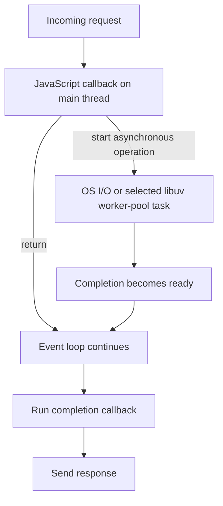

# Assignment 01 - Node.js fundamentals

**Source:** MCWD203T-AS01.docx. All ten questions are answered. Run the accompanying examples with Node.js 24 or another compatible supported release. Sample names and values are illustrative.

## Q1. What is Node.js?

Node.js is a JavaScript runtime that runs JavaScript outside a web browser. A runtime supplies the engine and environment needed to execute a program: APIs, module loading, process access, and integration with the operating system. Node provides filesystem, network and process APIs; browser objects such as `document` are not part of its normal environment.

The **V8 engine** parses and executes JavaScript, including compilation and memory management. **libuv** supplies event-loop infrastructure and cross-platform asynchronous I/O support, including a worker pool used by selected operations. It does not mean that every request runs in a separate worker thread. Four useful features are event-driven asynchronous I/O, JavaScript on the server, a large package ecosystem, and cross-platform development. These make Node suitable for many I/O-oriented services, while application design still determines reliability and performance.

## Q2. Roles and usage

- **Web servers:** receive HTTP requests and send HTML, files or JSON.
- **REST APIs:** expose resources through routes and connect them to application/database logic.
- **Real-time applications:** exchange updates over persistent connections, such as a chat or collaborative dashboard.
- **Microservices:** implement a bounded service with a network interface and independent deployment.
- **CLI tools:** process files, automate builds or provide developer commands.

Two poor fits for a straightforward single-event-loop design are long CPU-intensive work, such as large synchronous image transformations, and hard real-time systems requiring guaranteed response deadlines. CPU work blocks other JavaScript callbacks unless partitioned or moved to worker threads/processes or an external service. Node may still coordinate such systems; the point is that asynchronous syntax does not make CPU-bound calculations parallel. Choose technology based on workload, team expertise and operational requirements rather than the claim that one runtime is universally fastest.

## Q3. Five ES6 features and module systems

```javascript
let attempts = 1;             // Block scope; reassignment allowed.
const student = { name: 'Chirag', course: 'MCA' }; // Binding is fixed.
student.course = 'MCA III';   // const does not freeze the object.
const double = n => n * 2;    // Arrow function; lexical this.
console.log(`${student.name}: ${double(attempts)}`); // Template literal.
const { name, course } = student;  // Object destructuring.
const marks = [70, 80];
const updated = [...marks, 90];    // Spread creates a shallow copy.
const total = (...values) => values.reduce((a, b) => a + b, 0); // Rest.
console.log(name, course, total(...updated));
```

Expected output is `Chirag: 2` followed by `Chirag MCA III 240`. `let` and `const` prevent accidental function-wide `var` scope; arrow functions simplify callbacks but are not substitutes for methods needing their own `this`. Destructuring extracts named fields, while spread expands values and rest collects them. Copies remain shallow, so nested objects can still be shared.

| CommonJS | ES modules |
|---|---|
| `const add = require('./add.cjs')` | `import { add } from './add.js'` |
| `module.exports = add` | `export const add = (a,b) => a+b` |
| Traditional Node module system | Standard JavaScript module syntax |
| `.cjs` explicitly selects CommonJS | `.mjs` or `"type":"module"` selects ESM for this project |

ES modules support static structure and dynamic `import()`. Interoperability rules depend on the runtime and package; do not blindly mix the syntaxes. The supplied examples use ESM consistently.

## Q4. Process model and event loop

A typical Node process executes application JavaScript on one main event-loop thread. It can start many I/O operations without waiting synchronously for each result. The operating system handles much network I/O; selected filesystem, DNS and other operations use libuv's worker pool. Completed work becomes eligible for callbacks, which run when the main thread can process them. Node also has other internal threads and explicit worker-thread support, so “single-threaded” describes the usual JavaScript execution path, not every part of the process.



Conceptual event-loop phases include timers, pending callbacks, internal preparation, polling for I/O, check callbacks and close callbacks. Promise microtasks and `process.nextTick` are additional scheduling mechanisms, not ordinary phases in that list. Exact ordering depends on context; do not promise that a zero-delay timer runs immediately. If one request executes a ten-second synchronous loop, other JavaScript callbacks must wait. Keep callbacks bounded, stream large data where appropriate, and move expensive CPU work elsewhere. Concurrency means overlapping progress; it is not the same as parallel execution of JavaScript on this thread.

## Q5. npm and npx

`npm` is the package manager CLI and part of a broader package ecosystem. It installs dependencies, runs scripts and manages package metadata. `npx` (implemented through npm's execution facilities) runs package-provided commands, using installed packages or fetching a requested package when necessary. Check package identity and version before executing unfamiliar commands.

```bash
node --version
npm --version
npx --version
npm install express          # Local runtime dependency
npm install --save-dev nodemon
npm update express           # Update within the allowed manifest range
npm uninstall express
npm install --global npm-check-updates  # Example global CLI installation
```

Local installations belong to the project and are the usual choice for reproducibility. Global installations provide user/machine-level command-line tools, but collaborators do not automatically receive them. `dependencies` lists packages needed when the application runs; `devDependencies` lists tooling such as formatters or build/test tools. A built frontend may need its build tools during CI even though its production server serves only the resulting static assets. Commit `package-lock.json`; use `npm ci` for an installation that follows the lockfile.

## Q6. Installing Node on Windows and using the REPL

Download an appropriate supported installer from [nodejs.org](https://nodejs.org/en/download). Choose the correct CPU architecture, run the installer and include the npm/PATH options. Open a **new terminal** afterward, then run `node --version` and `npm --version`. For this repository, Node 24 was used for validation.

Run `node` with no filename to enter the Read-Eval-Print Loop. Typing `2 + 3` prints `5`; `.exit` leaves the session. Save `console.log('Hello, MCA');` in `hello.js` and execute `node hello.js` from its directory. The Node REPL is not a browser console and does not provide a page DOM.

If “node is not recognized” appears, reopen the terminal and verify the installer added the correct directory to PATH; use `where.exe node` to check for conflicting installations. If PowerShell blocks `npm.ps1`, use `npm.cmd` from the same installation or use Command Prompt; a broad security-policy change is unnecessary for running the CLI. If an old version still appears, inspect PATH order or the selected version-manager environment rather than repeatedly installing more copies.

## Q7. Project setup and Express server

```bash
mkdir college-server
cd college-server
npm init -y
npm install express
npm install --save-dev nodemon
```

Set `"type":"module"`, `"start":"node server.js"` and `"dev":"nodemon server.js"` in `package.json`. A complete manifest and [server.js](server.js) are included in this assignment folder, so here simply run `npm ci`, then `npm start` (or `npm run dev`). Open `http://127.0.0.1:3100` to receive `{"message":"Hello from the MCA Node.js assignment"}`. Stop with Ctrl+C.

`package.json` describes the project's metadata, scripts and dependency ranges. `package-lock.json` records the resolved dependency graph and integrity information for repeatable installation. Do not manually edit the lockfile to fake a dependency version. `node_modules` contains installed package files and should not be committed. The server deliberately binds to loopback for local practice; no public deployment or firewall change is needed.

## Q8. Typical Express project structure

```text
college-server/
  src/
    server.js       # Start listening and connect dependencies
    routes/         # Map HTTP paths and methods to handlers
    controllers/    # Parse requests and build responses
    models/         # Data access and domain rules
    middleware/     # Validation, logging and authentication
    config/         # Validated configuration loading
  public/           # Static browser assets
  node_modules/     # Installed dependencies, ignored by Git
  .env              # Local configuration/secrets, ignored by Git
  .env.example      # Safe example variable names, committed
  .gitignore
  package.json
  package-lock.json
```

The separation makes responsibilities easier to locate and test; it is a convention rather than a mandatory Node layout. Routes should not become a mixture of unrelated database, validation and rendering logic. `.env` files are not automatically secret merely because they start with a dot: explicitly ignore them and never send them to the browser. Commit an example containing safe placeholders, not real credentials. Small exercises may use fewer files; introduce layers when they clarify the program.

## Q9. Editors and debugging

| Editor/IDE | Useful characteristics | Consideration |
|---|---|---|
| Visual Studio Code | Integrated terminal, JavaScript/TypeScript tooling, Git and Node debugger, extension ecosystem | Some capabilities are added through extensions and project configuration. |
| WebStorm | Integrated JavaScript refactoring, navigation, testing and debugging | Licensing and resource needs should be checked for the intended use. |
| Sublime Text | Lightweight text editing, multi-cursor workflows and package customization | A complete Node debugging workflow usually needs additional setup/tools. |

VS Code is popular because common editing, terminal and debugging tasks fit in one workspace. Four useful extensions are ESLint (`dbaeumer.vscode-eslint`) for lint findings, Prettier (`esbenp.prettier-vscode`) for formatting, EditorConfig (`EditorConfig.EditorConfig`) for shared editor conventions, and npm Intellisense (`christian-kohler.npm-intellisense`) for import completion. Install only what the project needs; formatting and linting rules should agree.

To debug, open the project, set a breakpoint in `server.js`, and use a Node launch configuration or VS Code's JavaScript Debug Terminal. Start the program, trigger an HTTP request, inspect local variables, step over a line and resume execution. Breakpoints pause execution, so a client may wait while the program is stopped. Never paste production secrets into public debug logs.

## Q10. Blocking, non-blocking and async/await

| Blocking | Non-blocking |
|---|---|
| Caller waits for completion before continuing | Starts work and continues; completion is handled later |
| `readFileSync` returns contents directly | `readFile` delivers an error/result to a callback |
| Simple for short one-off scripts | Usually preferable in request handlers serving concurrent clients |
| Long operations delay the event loop | Callback code can still block if it performs heavy computation |

Run `node blocking.cjs`: output is `Start`, `Hello MCA`, `End`. Run `node nonblocking.cjs`: output is `Start`, `End`, `Hello MCA`. Both read the included file relative to the script, so the working directory does not change the result.

Run `node async-await.js`: output is `Start`, `Scheduled`, `Hello MCA`, `Finished`. `await` suspends that asynchronous function until its promise settles; it does not block the whole event loop. `try/catch` handles rejection and makes a sequence of asynchronous operations readable without deeply nested callbacks. An `async` function containing a long synchronous loop still blocks the main thread.

References: [Node event loop](https://nodejs.org/learn/asynchronous-work/event-loop-timers-and-nexttick), [Avoid blocking](https://nodejs.org/learn/asynchronous-work/dont-block-the-event-loop), [npm CLI](https://docs.npmjs.com/cli/), [VS Code Node debugging](https://code.visualstudio.com/docs/nodejs/nodejs-debugging).
