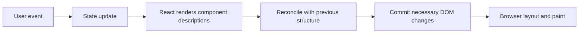

# Assignment 02 - Introduction to React

**Source:** MCWD203T-AS03.docx (the source title is Assignment 2). All five questions are answered; the included small counter app demonstrates rendering, state and the boot process.

## Q1. Purpose, features, advantages and disadvantages

React is a JavaScript library for building user interfaces from components. A component describes the UI for its current inputs and state. Rather than manually finding DOM elements and synchronizing every change, the developer expresses the desired view and React coordinates rendering and updates. JSX is a convenient syntax for describing elements; it is transformed into JavaScript during the build.

Important features include reusable components, props for passing inputs, state for changing local data, hooks for component capabilities, and declarative rendering. Data normally flows from parent to child through props; events can request state changes in a parent. This makes dependencies easier to reason about than many unrelated scripts modifying the same elements.

Advantages include reuse, composable interfaces, a broad ecosystem and a consistent way to connect state to presentation. Limitations include the need to understand JavaScript and rendering behavior, decisions about routing/data fetching/build tools, and performance problems if expensive rendering is designed poorly. React is not a complete database or backend framework, and a Virtual DOM does not guarantee faster execution than every carefully written DOM update. For a tiny static page, additional tooling may be unnecessary. Choose it when component-driven interaction provides useful structure.

## Q2. SPAs and multi-page applications

A Single Page Application loads a browser application and changes views primarily with JavaScript. The initial response delivers HTML and assets. Event handlers, client-side routing and network requests then update the displayed content; changing a route often does not require replacing the whole document. The browser history must still be managed so Back, Forward and deep links behave correctly.

| SPA | Traditional multi-page application |
|---|---|
| Many navigations update an existing document | Navigation commonly requests a new HTML document |
| Client maintains substantial UI state | Server often constructs each complete page |
| Can provide smooth transitions after loading | Straightforward document navigation and initial server-rendered content |
| Needs deliberate handling of bundles, routing and loading/errors | May repeat shared assets or full-page transitions, although caching helps |

An SPA still communicates with servers for authentication, data and persistence. A multi-page site can also contain rich JavaScript interaction. Modern applications may combine server rendering, hydration and client navigation, so the distinction is not an absolute divide. An SPA must handle initial load performance, accessibility after route changes, authorization on the server and search-engine requirements. Configure hosting so direct visits to client routes load the application, while actual API errors are not accidentally replaced by HTML.

## Q3. DOM and Virtual DOM

The DOM is the browser's object representation of a document. JavaScript can use it to create elements, change text and attach events; the browser uses the resulting document and styles for layout and painting. React's in-memory element descriptions are often called the Virtual DOM. They describe UI output, but they are not a second browser document and do not perform layout themselves.



On the first render, React creates the relevant DOM nodes. After a state change, it renders the affected component tree and determines which DOM changes are required. A render may result in no DOM change if the relevant output is unchanged. Stable keys help React associate list items across renders; array indexes can be problematic when items are reordered or inserted. Rendering should remain pure: network requests and other external synchronization belong in appropriate handlers/effects, not as uncontrolled side effects during rendering. The benefit is predictable UI programming and coordinated updates, not a promise that every render is free.

## Q4. Development environment

Install a supported Node.js version and npm, choose a code editor, and use a browser with developer tools. Node runs the development server and build tooling; it does not become the browser's JavaScript engine. npm installs React, React DOM and build dependencies, while the editor provides syntax help, navigation and debugging. A build tool such as Vite serves modules during development and produces optimized static assets for deployment.

Check `node --version` and `npm --version` before installation. Keep project dependencies local and commit the lockfile. For a learning application that explores React fundamentals, a small Vite project is appropriate; larger applications may benefit from a framework that coordinates routing, rendering and data loading. Do not assume that a development server is a production deployment. Frontend environment variables are bundled or delivered to the browser and must not contain private API secrets.

The included application uses a package manifest and lockfile so another student can install the same dependency graph. Its single component is intentionally small enough to follow each state change. Browser developer tools show the DOM, network requests and console; React developer tooling can help inspect components.

## Q5. Create, run and understand the boot process

To create a fresh learning project:

```bash
npm create vite@latest my-react-app -- --template react
cd my-react-app
npm install
npm run dev
```

For **this supplied folder**, use `npm ci` followed by `npm run dev`, and open the local URL printed by Vite. `npm run build` creates `dist`; `npm run preview` serves that build locally for checking.

Boot sequence: the browser requests `index.html`; the HTML provides `<div id="root">`; its module script loads `src/main.jsx`; `createRoot` attaches React to that element; `root.render` renders `App`; React commits the element tree; the browser paints it. Clicking “Complete one exercise” calls the event handler, updates state and triggers a render with a new count. The updater form `setCount(value => value + 1)` computes from the previous state. Refreshing resets this illustrative local state because no persistence is implemented.

Expected initial output is “COER MCA - React practice” and “Completed exercises: 0”. One click changes the count to 1; Reset returns it to 0. The code is in [src/App.jsx](src/App.jsx) and [src/main.jsx](src/main.jsx).

References: [React from scratch](https://react.dev/learn/build-a-react-app-from-scratch), [React render and commit](https://react.dev/learn/render-and-commit), [Vite guide](https://vite.dev/guide/).
