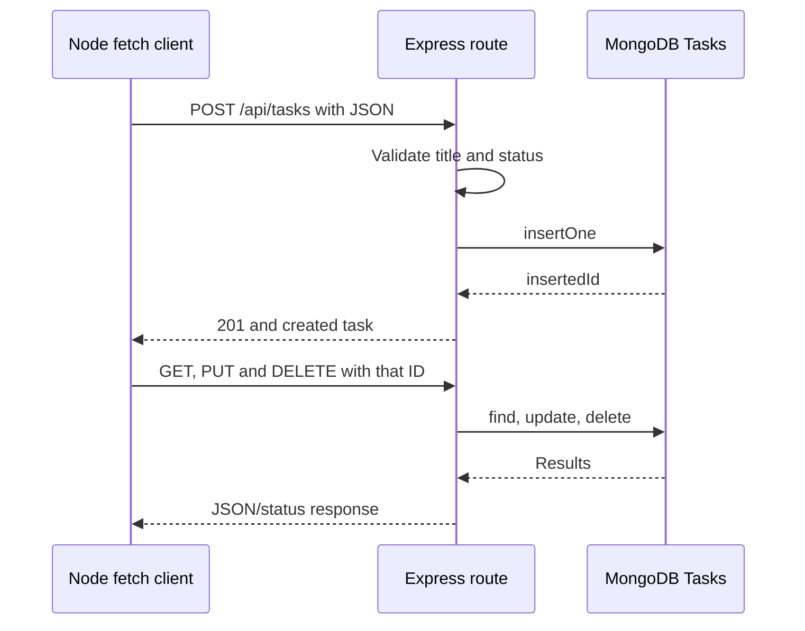

# Assignment 05 - MongoDB and Node.js programming

**Source:** MCWD203T-AS05.docx. All five programming tasks are implemented. Examples use synthetic records; connection strings are loaded from the environment. The APIs listen only on loopback and are intended for local lab practice.

## Setup and run

Use Node.js 24. Run `npm ci` in this folder. For a temporary practice database, run `npm run demo:db` and leave that terminal open. This starts a real isolated MongoDB server at `mongodb://127.0.0.1:27019`; its data is discarded when stopped. The package may download the official MongoDB binary on first use. Alternatively, install MongoDB Community Server from its official download and use your local server's URI.

Copy `.env.example` to `.env` and set `MONGODB_URI` to the chosen local database. On Windows PowerShell, use `Copy-Item .env.example .env`. Do not commit `.env`. Open MongoDB Compass and connect to the same URI. Refresh databases after running the demonstrations to inspect CollegeDB, LibraryDB and AssignmentDemoDB. Compass is an optional visual verification tool; automated database tests are also included.

In another terminal:

```bash
npm run students
npm run employees
npm run books
npm start
```

While the API runs, execute `npm run client` in a third terminal. Run `npm test` separately to test all tasks against a fresh isolated database; it does not use the database configured in `.env`.

## Q1. CollegeDB / Students CRUD

[students.js](src/students.js) creates five sample students, each with studentId, name, course, semester and marks, then demonstrates insertion of a sixth student, listing all six, filtering MCA students, updating student 91001's marks to 92 and deleting student 91006. Stable demo IDs make the sample rerunnable without dropping a collection.

| Operation | Expected result |
|---|---|
| List after insertion | 6 sample documents |
| Find course MCA | Asha, Ravi, Kabir and Temporary Student |
| Update student 91001 | marks = 92 |
| Delete student 91006 | deletedCount = 1 |
| Final sample count | 5 |

In Compass select `CollegeDB > Students` and filter `{ "demo": "mca-assignment-05" }`. Check the five surviving records and the updated marks. The sample IDs and marker identify this exercise's data; the script does not delete unrelated collections.

## Q2. Employees queries and aggregation

[employees.js](src/employees.js) inserts sample employees in `CollegeDB.Employees`. It uses `$gt` for a salary threshold, `.sort({salary:-1})` for descending order and a pipeline with `$group`, `$avg`, `$sum` and a subsequent `$match` to filter department summaries.

| Department | Salaries | Average | Count |
|---|---|---:|---:|
| HR | 40000, 50000 | 45000 | 2 |
| IT | 60000, 80000 | 70000 | 2 |
| Sales | 90000 | 90000 | 1 |

Salary **greater than** 60000 returns 90000 and 80000; exactly 60000 is excluded. Descending order is 90000, 80000, 60000, 50000, 40000. Departments with average salary above 60000 are IT and Sales. The post-group filter uses `averageSalary`, because that field is produced by the aggregation; filtering individual salaries before grouping answers a different question.

## Q3. LibraryDB / Books with the official driver

[books.js](src/books.js) provides separate `addBook`, `getAllBooks`, `findBookByISBN`, `updateBook` and `deleteBook` functions. It creates a unique ISBN index, validates values, uses parameter values rather than raw query objects, and returns the updated document. [books-demo.js](src/books-demo.js) connects using the environment, demonstrates every function, handles errors and closes the client in `finally`.

Expected flow: insert a synthetic book priced 499 and available; retrieve it; update price to 449 and availability to false; delete it with deletedCount 1. The demo uses a unique synthetic ISBN-like identifier and removes only its own created book. A duplicate ISBN produces a database duplicate-key error rather than silently overwriting a book. `LibraryDB.Books` is empty afterward if it contained no other books; inspect or pause the script before deletion to see the intermediate document in Compass.

## Q4. Product REST CRUD API

[app.js](src/app.js) implements the following endpoints with the official driver and Express 5. [server.js](src/server.js) connects and listens on `http://127.0.0.1:3200`.

| Method/path | Request body | Success |
|---|---|---|
| POST `/api/products` | `{"name":"Keyboard","price":1200,"stock":5}` | 201 and created object, with Location header |
| GET `/api/products` | None | 200 and JSON array |
| GET `/api/products/:id` | None | 200 and one object |
| PUT `/api/products/:id` | `{"name":"Keyboard","price":1100,"stock":4}` | 200 and updated object |
| DELETE `/api/products/:id` | None | 204, empty body |

Copy `_id` from POST into subsequent URLs. PUT supplies all editable fields. Names must be nonempty, prices nonnegative finite numbers and stock nonnegative integers. Unexpected fields are rejected. Invalid IDs return 400, well-formed missing IDs return 404, malformed JSON returns 400 and oversized bodies return 413. Internal failures return a generic 500 without exposing credentials. An equivalent API client using Node's `fetch` tests every endpoint in [integration.test.js](test/integration.test.js); actual requests/responses are saved under `evidence/` when it passes.

Example using PowerShell:

```powershell
$product = Invoke-RestMethod http://127.0.0.1:3200/api/products -Method Post -ContentType 'application/json' -Body '{"name":"Keyboard","price":1200,"stock":5}'
Invoke-RestMethod "http://127.0.0.1:3200/api/products/$($product._id)"
Invoke-RestMethod "http://127.0.0.1:3200/api/products/$($product._id)" -Method Put -ContentType 'application/json' -Body '{"name":"Keyboard","price":1100,"stock":4}'
Invoke-RestMethod "http://127.0.0.1:3200/api/products/$($product._id)" -Method Delete
```

## Q5. Tasks API and end-to-end client

[client.js](src/client.js) sends requests using Node's built-in `fetch`: POST a task, GET the list, PUT status `done`, DELETE that task, then GET the remaining list. The API stores records in `AssignmentDemoDB.Tasks`; accepted states are `pending`, `in-progress` and `done`. The client checks `response.ok`, prints status codes and cleans up its own created task if a later step fails. Existing tasks are preserved.



Expected statuses are 201, 200, 200, 204 and 200 in sequence. The last list omits the created task. Authentication and public hosting are outside this local lab example; do not expose the demonstration API as a production service.

## Verification and viva cues

`npm test` starts a real temporary mongod instance and checks CRUD, aggregation, duplicate ISBNs, response bodies, malformed IDs, invalid values and missing records. It writes [integration-results.json](evidence/integration-results.json) only after successful assertions. Object IDs and the temporary database port can differ between runs.

- Database contains collections; a collection contains BSON documents.
- `$match` filters; `$group` aggregates; `$set` updates selected fields.
- 201 means created; 204 has no response body; 400 differs from 404.
- `await` waits inside the async function; `finally` releases resources.
- Client validation improves usability; server validation remains necessary.

References: [MongoDB Node driver](https://www.mongodb.com/docs/drivers/node/current/), [MongoDB Compass](https://www.mongodb.com/docs/compass/current/connect/), [Express routing](https://expressjs.com/en/guide/routing.html).
