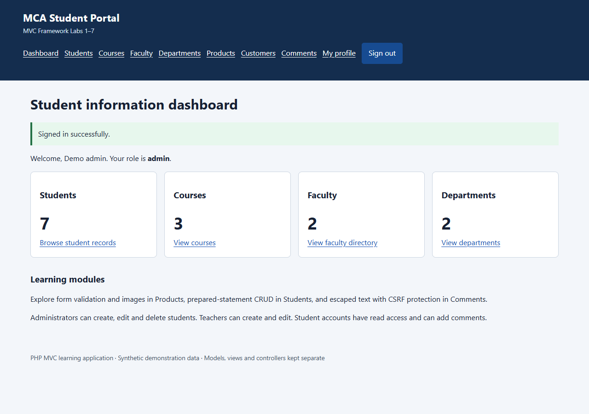

# MVC Lab Sheet 1 — MVC architecture and project structure

Source: `docx (9).docx`. 15 implementation tasks. Instructor: Hemendra Shankar Sharma. All seven sheets use the same runnable [PHP application](../Application/) so shared code is maintained once.

## Aim and setup

Implement and demonstrate mvc architecture and project structure using PHP 8+ and PDO MySQL. Follow the [application setup](../Application/README.md) before running this sheet. Database scripts and synthetic seed data are included; no ERP or real student data is used.

## Task-wise implementation

| No. | Source task | Code | Behavior |
|---:|---|---|---|
| 1 | Create MVC directory structure | [app/](../Application/app/) | Separate Core, Controllers, Models, Views, Helpers and Middleware directories; public is the document root. |
| 2 | Create StudentModel | [app/Models/StudentModel.php](../Application/app/Models/StudentModel.php) | The model owns prepared student queries and returns data without generating HTML. |
| 3 | Create StudentController | [app/Controllers/StudentController.php](../Application/app/Controllers/StudentController.php) | Actions coordinate requests, validation, model calls and view data. |
| 4 | Create Student View | [app/Views/students/index.php](../Application/app/Views/students/index.php) | A table renders student rows and role-appropriate actions. |
| 5 | Pass data from Controller to View | [app/Core/View.php](../Application/app/Core/View.php) | Controller data is extracted with EXTR_SKIP and consumed by the selected template. |
| 6 | Create CourseModel | [app/Models/CourseModel.php](../Application/app/Models/CourseModel.php) | all and find retrieve course records. |
| 7 | Create CourseController | [app/Controllers/CourseController.php](../Application/app/Controllers/CourseController.php) | index lists courses; show reads a numeric route parameter. |
| 8 | Create Course View | [app/Views/courses.php](../Application/app/Views/courses.php) | Reusable cards show course name, ID and duration. |
| 9 | Create reusable Header View | [app/Views/partials/header.php](../Application/app/Views/partials/header.php) | Common title, navigation, flash and error summary appear on every HTML page. |
| 10 | Create reusable Footer View | [app/Views/partials/footer.php](../Application/app/Views/partials/footer.php) | Common closing markup and learning-data note are included once. |
| 11 | Create Faculty Module | [app/Controllers/FacultyController.php](../Application/app/Controllers/FacultyController.php) | FacultyModel joins department information; the directory view displays it. |
| 12 | Create Department Module | [app/Controllers/DepartmentController.php](../Application/app/Controllers/DepartmentController.php) | DepartmentModel supplies records to the directory view. |
| 13 | Create BaseController class | [app/Core/BaseController.php](../Application/app/Core/BaseController.php) | Common view and local redirect helpers are inherited by controllers. |
| 14 | Implement common View rendering | [app/Core/View.php](../Application/app/Core/View.php) | One renderer loads header, selected template and footer. |
| 15 | Integrate modules into Dashboard | [app/Controllers/DashboardController.php](../Application/app/Controllers/DashboardController.php) | Dashboard combines student total and course, faculty and department counts. |

## Procedure

1. Sign in using the locally created admin account.
2. Open Dashboard and follow Students, Courses, Faculty and Departments.
3. Open course 1 and compare the returned record with the database seed.
4. Trace one request from routes.php to controller, model and view.

## Request flow and wireframe

```text
Browser -> public/index.php -> Request -> Router -> middleware
        -> controller -> model/PDO -> MySQL
        -> view + header/footer OR JSON response

+---------------------------------------------------+
| Portal title | Dashboard | Modules | Profile       |
+---------------------------------------------------+
| Page heading and success/error message             |
| Form / records / API result for the current module |
| Labeled controls, validation and navigation        |
+---------------------------------------------------+
| Common footer                                     |
+---------------------------------------------------+
```

## Observed output



The screenshot was captured from the running application. See [verification results](../../VERIFICATION.md) and the machine-readable [integration report](../../verification/hemendra-results.json) for executed checks. Screenshots use demonstration accounts and synthetic records.

## Brief implementation report

This sheet's responsibilities are mapped to explicit classes and templates above. Models own persistence; controllers select the workflow; the router applies authentication and role rules before dispatch. Dynamic HTML output is escaped, state-changing requests carry CSRF tokens and database values are bound through PDO. The integrated version keeps later security improvements active while demonstrating earlier MVC concepts.

The application is a classroom implementation. A production deployment would also require HTTPS configuration, operational monitoring, backup/restore, account recovery, retention policy and a deployment-specific security review. No production-readiness certification is claimed.

## Viva questions

- Why should a model not echo HTML?
- How does MVC differ from placing SQL directly inside a page?
- What does a reusable base controller provide?

Source note: `docx (10).docx` is an identical second copy of this lab; it has no separate implementation or QR.
