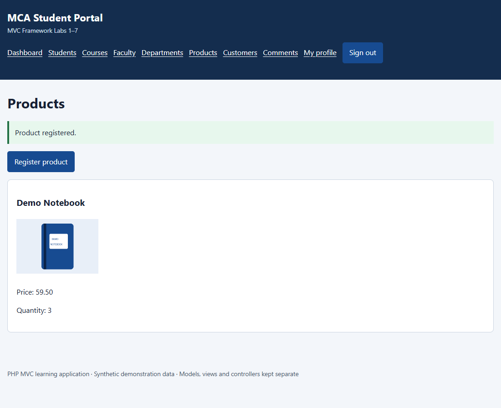

# MVC Lab Sheet 2 — Controllers and form processing

Source: `docx (11).docx`. 15 implementation tasks. Instructor: Hemendra Shankar Sharma. All seven sheets use the same runnable [PHP application](../Application/) so shared code is maintained once.

## Aim and setup

Implement and demonstrate controllers and form processing using PHP 8+ and PDO MySQL. Follow the [application setup](../Application/README.md) before running this sheet. Database scripts and synthetic seed data are included; no ERP or real student data is used.

## Task-wise implementation

| No. | Source task | Code | Behavior |
|---:|---|---|---|
| 1 | Create ProductController | [app/Controllers/ProductController.php](../Application/app/Controllers/ProductController.php) | Coordinates product listing, registration and controlled image delivery. |
| 2 | Create Product Registration Form | [app/Views/products/form.php](../Application/app/Views/products/form.php) | POST multipart form has labels, CSRF token and optional image input. |
| 3 | Implement create action | [app/Controllers/ProductController.php](../Application/app/Controllers/ProductController.php) | create renders an empty registration form. |
| 4 | Implement store action | [app/Controllers/ProductController.php](../Application/app/Controllers/ProductController.php) | store validates data, saves an accepted upload and inserts the product. |
| 5 | Validate Product Name | [app/Helpers/ValidationHelper.php](../Application/app/Helpers/ValidationHelper.php) | Name must contain 2–100 bytes after trimming. |
| 6 | Validate Product Price | [app/Helpers/ValidationHelper.php](../Application/app/Helpers/ValidationHelper.php) | Positive decimal with at most eight integer digits and two fractional digits. |
| 7 | Validate Product Quantity | [app/Helpers/ValidationHelper.php](../Application/app/Helpers/ValidationHelper.php) | Integer between zero and one million; zero stock is accepted. |
| 8 | Display Validation Errors | [app/Views/partials/header.php](../Application/app/Views/partials/header.php) | Escaped error list has role=alert; invalid submissions return HTTP 422. |
| 9 | Preserve Previously Entered Values | [app/Views/products/form.php](../Application/app/Views/products/form.php) | Safe scalar values are returned to the form; browsers require reselecting file inputs. |
| 10 | Implement Redirect Functionality | [app/Core/Response.php](../Application/app/Core/Response.php) | A successful POST uses a local 303 redirect to prevent refresh resubmission. |
| 11 | Create ValidationHelper class | [app/Helpers/ValidationHelper.php](../Application/app/Helpers/ValidationHelper.php) | Reusable field checks keep validation outside templates. |
| 12 | Implement Product Image Upload | [app/Helpers/SecurityHelper.php](../Application/app/Helpers/SecurityHelper.php) | Checks upload status, size, real MIME and dimensions before moving it. |
| 13 | Store Image Names | [app/Models/ProductModel.php](../Application/app/Models/ProductModel.php) | Only a random basename is saved in image_name; content stays outside public. |
| 14 | Implement Flash Messages | [app/Core/BaseController.php](../Application/app/Core/BaseController.php) | Success text is stored in the session and consumed once by the header. |
| 15 | Develop Customer Registration Module | [app/Controllers/CustomerController.php](../Application/app/Controllers/CustomerController.php) | Validates name, email and phone; handles duplicate email and displays registered customers. |

## Procedure

1. Open Products → Register product.
2. Submit invalid price/quantity through an HTTP client to exercise server validation beyond browser checks.
3. Register Demo Notebook with price 59.50, quantity 3 and a valid PNG.
4. Try a text file disguised as PNG; it must be rejected.
5. Open Customers and submit valid synthetic details.

## Request flow and wireframe

```text
Browser -> public/index.php -> Request -> Router -> middleware
        -> controller -> model/PDO -> MySQL
        -> view + header/footer OR JSON response

+---------------------------------------------------+
| Portal title | Dashboard | Modules | Profile       |
+---------------------------------------------------+
| Page heading and success/error message             |
| Form / records / API result for the current module |
| Labeled controls, validation and navigation        |
+---------------------------------------------------+
| Common footer                                     |
+---------------------------------------------------+
```

## Observed output



The screenshot was captured from the running application. See [verification results](../../VERIFICATION.md) and the machine-readable [integration report](../../verification/hemendra-results.json) for executed checks. Screenshots use demonstration accounts and synthetic records.

## Brief implementation report

This sheet's responsibilities are mapped to explicit classes and templates above. Models own persistence; controllers select the workflow; the router applies authentication and role rules before dispatch. Dynamic HTML output is escaped, state-changing requests carry CSRF tokens and database values are bound through PDO. The integrated version keeps later security improvements active while demonstrating earlier MVC concepts.

The application is a classroom implementation. A production deployment would also require HTTPS configuration, operational monitoring, backup/restore, account recovery, retention policy and a deployment-specific security review. No production-readiness certification is claimed.

## Viva questions

- Why use multipart/form-data?
- Why can a file input not be repopulated automatically?
- What does POST/Redirect/GET prevent?
