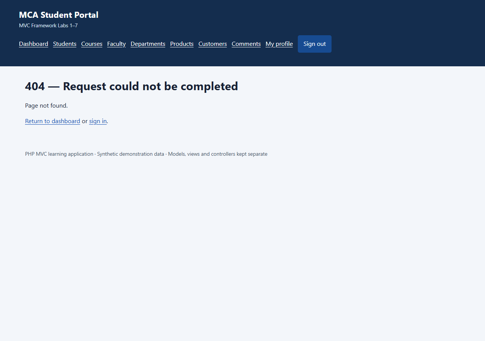

# MVC Lab Sheet 3 — Front controller and routing

Source: `docx (12).docx`. 15 implementation tasks. Instructor: Hemendra Shankar Sharma. All seven sheets use the same runnable [PHP application](../Application/) so shared code is maintained once.

## Aim and setup

Implement and demonstrate front controller and routing using PHP 8+ and PDO MySQL. Follow the [application setup](../Application/README.md) before running this sheet. Database scripts and synthetic seed data are included; no ERP or real student data is used.

## Task-wise implementation

| No. | Source task | Code | Behavior |
|---:|---|---|---|
| 1 | Create Front Controller | [public/index.php](../Application/public/index.php) | Every application request enters one bootstrap and exception boundary. |
| 2 | Read REQUEST_URI | [app/Core/Request.php](../Application/app/Core/Request.php) | parse_url selects the path without query-string data. |
| 3 | Sanitize URI | [app/Core/Request.php](../Application/app/Core/Request.php) | Decode once and reject unsupported characters, encoded slash/backslash and NUL. |
| 4 | Parse Controller Name | [routes.php](../Application/routes.php) | A matched route selects the allowlisted controller class; no arbitrary URI class names. |
| 5 | Parse Action Name | [routes.php](../Application/routes.php) | Each configured route names its permitted action. |
| 6 | Load Controller Dynamically | [bootstrap.php](../Application/bootstrap.php) | Namespace autoloader maps known App classes to application files. |
| 7 | Execute Methods Dynamically | [app/Core/Router.php](../Application/app/Core/Router.php) | The matched configured callable receives Request and extracted parameters. |
| 8 | Implement Default Routes | [routes.php](../Application/routes.php) | Root maps to DashboardController index; login is the guest entry route. |
| 9 | Create Custom 404 Error Page | [app/Views/error.php](../Application/app/Views/error.php) | Unknown route produces an HTTP 404 and a useful HTML explanation. |
| 10 | Support Clean URLs | [public/.htaccess](../Application/public/.htaccess) | Apache rewrite rules or the PHP development router forward navigation paths. |
| 11 | Support Parameterized URLs | [routes.php](../Application/routes.php) | /students/{id} and /courses/{id} identify records. |
| 12 | Extract Route Parameters | [app/Core/Router.php](../Application/app/Core/Router.php) | Named placeholders match positive numeric segments and are passed as arguments. |
| 13 | Implement Route Class | [app/Core/Router.php](../Application/app/Core/Router.php) | Router stores route definitions and dispatches exact method/path matches. |
| 14 | Create Central Route Table | [routes.php](../Application/routes.php) | All HTML and API routes, methods and middleware live in one file. |
| 15 | Integrate Student and Course Modules | [app/Controllers/StudentController.php](../Application/app/Controllers/StudentController.php) | Both modules are reached through the same router and common request/response rules. |

## Procedure

1. After sign-in visit /courses/1 and /students/1.
2. Visit /missing-route and confirm HTTP 404 rather than a misleading 200 response.
3. POST to /courses and confirm 405.
4. Read the route table and identify the controller, action and parameter for each URL.

## Request flow and wireframe

```text
Browser -> public/index.php -> Request -> Router -> middleware
        -> controller -> model/PDO -> MySQL
        -> view + header/footer OR JSON response

+---------------------------------------------------+
| Portal title | Dashboard | Modules | Profile       |
+---------------------------------------------------+
| Page heading and success/error message             |
| Form / records / API result for the current module |
| Labeled controls, validation and navigation        |
+---------------------------------------------------+
| Common footer                                     |
+---------------------------------------------------+
```

## Observed output



The screenshot was captured from the running application. See [verification results](../../VERIFICATION.md) and the machine-readable [integration report](../../verification/hemendra-results.json) for executed checks. Screenshots use demonstration accounts and synthetic records.

## Brief implementation report

This sheet's responsibilities are mapped to explicit classes and templates above. Models own persistence; controllers select the workflow; the router applies authentication and role rules before dispatch. Dynamic HTML output is escaped, state-changing requests carry CSRF tokens and database values are bound through PDO. The integrated version keeps later security improvements active while demonstrating earlier MVC concepts.

The application is a classroom implementation. A production deployment would also require HTTPS configuration, operational monitoring, backup/restore, account recovery, retention policy and a deployment-specific security review. No production-readiness certification is claimed.

## Viva questions

- Why must user input not choose arbitrary PHP files?
- What is the difference between 404 and 405?
- Why remove query data before route matching?
