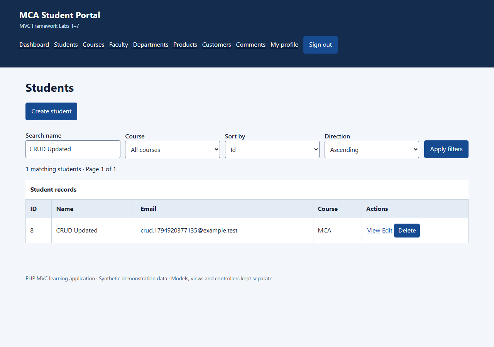

# MVC Lab Sheet 4 — PDO models and student CRUD

Source: `docx (13).docx`. 13 implementation tasks. Instructor: Hemendra Shankar Sharma. All seven sheets use the same runnable [PHP application](../Application/) so shared code is maintained once.

## Aim and setup

Implement and demonstrate pdo models and student crud using PHP 8+ and PDO MySQL. Follow the [application setup](../Application/README.md) before running this sheet. Database scripts and synthetic seed data are included; no ERP or real student data is used.

## Task-wise implementation

| No. | Source task | Code | Behavior |
|---:|---|---|---|
| 1 | PDO Connection | [app/Core/Database.php](../Application/app/Core/Database.php) | Reads credentials from process environment; enables exceptions and native prepared statements. |
| 2 | Create StudentModel | [app/Models/StudentModel.php](../Application/app/Models/StudentModel.php) | Encapsulates student reads, writes and list filtering. |
| 3 | Implement Create Operation | [app/Models/StudentModel.php](../Application/app/Models/StudentModel.php) | INSERT binds name, email and course; returns the new ID. |
| 4 | Implement Read Operation | [app/Models/StudentModel.php](../Application/app/Models/StudentModel.php) | find reads one record; browse joins course labels and paginates. |
| 5 | Implement Update Operation | [app/Models/StudentModel.php](../Application/app/Models/StudentModel.php) | UPDATE binds validated fields and an existing numeric ID. |
| 6 | Implement Delete Operation | [app/Models/StudentModel.php](../Application/app/Models/StudentModel.php) | DELETE is a CSRF-protected POST in HTML and admin-only DELETE in the API. |
| 7 | Search Student by Name | [app/Models/StudentModel.php](../Application/app/Models/StudentModel.php) | Bound LIKE parameter searches names without converting input into SQL syntax. |
| 8 | Search Student by Course | [app/Models/StudentModel.php](../Application/app/Models/StudentModel.php) | Optional numeric course filter is bound separately. |
| 9 | Implement Sorting | [app/Models/StudentModel.php](../Application/app/Models/StudentModel.php) | Only id/name/email and ASC/DESC are allowed as SQL identifiers/direction. |
| 10 | Implement Pagination | [app/Models/StudentModel.php](../Application/app/Models/StudentModel.php) | Five rows per page, total count, bounded page number and stable ID tiebreak. |
| 11 | Use Prepared Statements | [app/Core/BaseModel.php](../Application/app/Core/BaseModel.php) | Every user-supplied data value is passed through execute bindings. |
| 12 | Handle Exceptions | [public/index.php](../Application/public/index.php) | Expected duplicate/validation failures receive useful status codes; unexpected errors receive generic 500 text. |
| 13 | Complete Student CRUD System | [app/Controllers/StudentController.php](../Application/app/Controllers/StudentController.php) | Forms, list, detail, edit and delete are integrated with course validation and roles. |

## Procedure

1. Import schema.sql and seed.sql using the shared setup instructions.
2. Create a student with a synthetic unique email; view and edit the record.
3. Filter by name/course, change sort direction and navigate to page 2.
4. Try an SQL-like name search and verify that it returns no unrelated records.
5. Delete the test student as admin and verify it is absent.

## Request flow and wireframe

```text
Browser -> public/index.php -> Request -> Router -> middleware
        -> controller -> model/PDO -> MySQL
        -> view + header/footer OR JSON response

+---------------------------------------------------+
| Portal title | Dashboard | Modules | Profile       |
+---------------------------------------------------+
| Page heading and success/error message             |
| Form / records / API result for the current module |
| Labeled controls, validation and navigation        |
+---------------------------------------------------+
| Common footer                                     |
+---------------------------------------------------+
```

## Observed output



The screenshot was captured from the running application. See [verification results](../../VERIFICATION.md) and the machine-readable [integration report](../../verification/hemendra-results.json) for executed checks. Screenshots use demonstration accounts and synthetic records.

## Brief implementation report

This sheet's responsibilities are mapped to explicit classes and templates above. Models own persistence; controllers select the workflow; the router applies authentication and role rules before dispatch. Dynamic HTML output is escaped, state-changing requests carry CSRF tokens and database values are bound through PDO. The integrated version keeps later security improvements active while demonstrating earlier MVC concepts.

The application is a classroom implementation. A production deployment would also require HTTPS configuration, operational monitoring, backup/restore, account recovery, retention policy and a deployment-specific security review. No production-readiness certification is claimed.

## Viva questions

- Why cannot a placeholder safely stand for a column name?
- What does PDO exception mode change?
- Why validate the course foreign key before saving?
