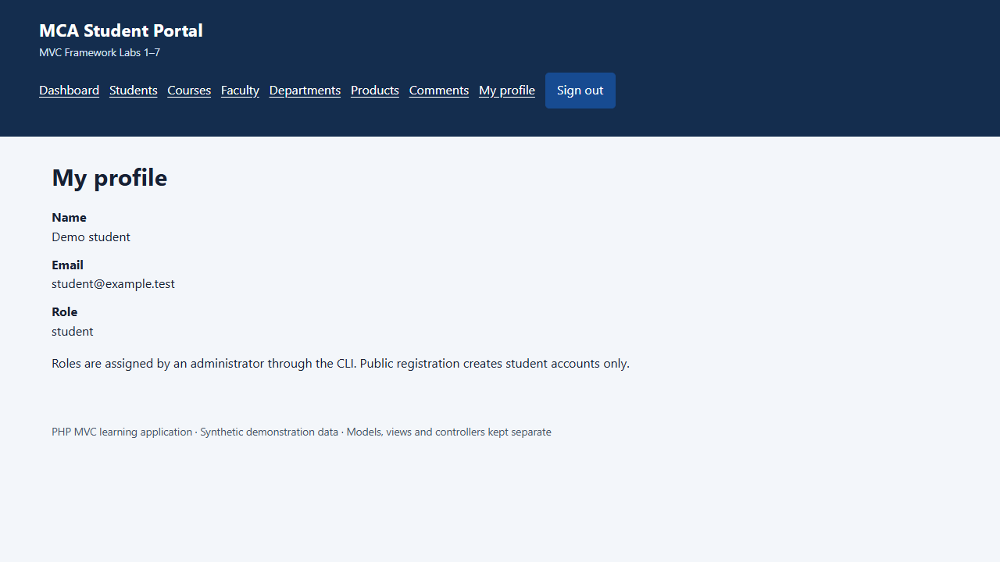

# MVC Lab Sheet 5 — Authentication and authorization

Source: `docx (14).docx`. 15 implementation tasks. Instructor: Hemendra Shankar Sharma. All seven sheets use the same runnable [PHP application](../Application/) so shared code is maintained once.

## Aim and setup

Implement and demonstrate authentication and authorization using PHP 8+ and PDO MySQL. Follow the [application setup](../Application/README.md) before running this sheet. Database scripts and synthetic seed data are included; no ERP or real student data is used.

## Task-wise implementation

| No. | Source task | Code | Behavior |
|---:|---|---|---|
| 1 | Create Users Table | [database/schema.sql](../Application/database/schema.sql) | Stores unique email, password hash and constrained admin/teacher/student role. |
| 2 | Create Registration Module | [app/Controllers/RegistrationController.php](../Application/app/Controllers/RegistrationController.php) | Public registration validates fields and always creates a student role. |
| 3 | Hash Passwords | [app/Models/UserModel.php](../Application/app/Models/UserModel.php) | password_hash with PASSWORD_DEFAULT creates a salted one-way hash. |
| 4 | Verify Passwords | [app/Controllers/LoginController.php](../Application/app/Controllers/LoginController.php) | password_verify compares a supplied password with the stored hash. |
| 5 | Create LoginController | [app/Controllers/LoginController.php](../Application/app/Controllers/LoginController.php) | Separates form display, credential submission and logout actions. |
| 6 | Implement Login Functionality | [app/Controllers/LoginController.php](../Application/app/Controllers/LoginController.php) | Valid credentials establish user_id and redirect to the dashboard. |
| 7 | Implement Logout Functionality | [app/Controllers/LoginController.php](../Application/app/Controllers/LoginController.php) | CSRF-protected POST clears session data, cookie and server session. |
| 8 | Session-Based Authentication | [bootstrap.php](../Application/bootstrap.php) | Strict cookie-only sessions with HttpOnly and SameSite=Lax; Secure on HTTPS. |
| 9 | Protect Dashboard Pages | [app/Middleware/AuthMiddleware.php](../Application/app/Middleware/AuthMiddleware.php) | Authenticated middleware runs before protected controller actions. |
| 10 | Redirect Unauthorized Users | [app/Middleware/AuthMiddleware.php](../Application/app/Middleware/AuthMiddleware.php) | Guests go to login for HTML; API guests receive 401; insufficient roles receive 403. |
| 11 | Add User Roles | [database/create-user.php](../Application/database/create-user.php) | CLI provisioning can assign roles; browser registration cannot elevate them. |
| 12 | Role-Based Access | [routes.php](../Application/routes.php) | Admin may delete; teachers create/edit; students read and comment. |
| 13 | Create User Profile Module | [app/Views/profile.php](../Application/app/Views/profile.php) | Displays current name/email/role without exposing password hashes. |
| 14 | Log Failed Login Attempts | [app/Models/UserModel.php](../Application/app/Models/UserModel.php) | Records email, IP and timestamp; five failures in 15 minutes trigger a temporary block. |
| 15 | Integrate Authentication | [routes.php](../Application/routes.php) | All student, course, directory, product, customer, comment and API routes carry appropriate middleware. |

## Procedure

1. Create local admin, teacher and student accounts through the CLI.
2. Compare the allowed actions for all three roles.
3. Attempt a write directly as student; hidden buttons alone are not the security check.
4. Sign out, then request the API and verify 401.
5. Use failed login attempts only in a disposable lab database to inspect logging/throttling.

## Request flow and wireframe

```text
Browser -> public/index.php -> Request -> Router -> middleware
        -> controller -> model/PDO -> MySQL
        -> view + header/footer OR JSON response

+---------------------------------------------------+
| Portal title | Dashboard | Modules | Profile       |
+---------------------------------------------------+
| Page heading and success/error message             |
| Form / records / API result for the current module |
| Labeled controls, validation and navigation        |
+---------------------------------------------------+
| Common footer                                     |
+---------------------------------------------------+
```

## Observed output



The screenshot was captured from the running application. See [verification results](../../VERIFICATION.md) and the machine-readable [integration report](../../verification/hemendra-results.json) for executed checks. Screenshots use demonstration accounts and synthetic records.

## Brief implementation report

This sheet's responsibilities are mapped to explicit classes and templates above. Models own persistence; controllers select the workflow; the router applies authentication and role rules before dispatch. Dynamic HTML output is escaped, state-changing requests carry CSRF tokens and database values are bound through PDO. The integrated version keeps later security improvements active while demonstrating earlier MVC concepts.

The application is a classroom implementation. A production deployment would also require HTTPS configuration, operational monitoring, backup/restore, account recovery, retention policy and a deployment-specific security review. No production-readiness certification is claimed.

## Viva questions

- How do authentication and authorization differ?
- Why regenerate the session ID after login?
- Why must public registration ignore a submitted admin role?
