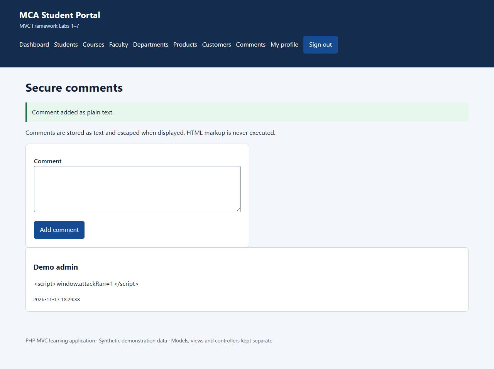

# MVC Lab Sheet 6 — MVC security controls

Source: `docx (16).docx`. 15 implementation tasks. Instructor: Hemendra Shankar Sharma. All seven sheets use the same runnable [PHP application](../Application/) so shared code is maintained once.

## Aim and setup

Implement and demonstrate mvc security controls using PHP 8+ and PDO MySQL. Follow the [application setup](../Application/README.md) before running this sheet. Database scripts and synthetic seed data are included; no ERP or real student data is used.

## Task-wise implementation

| No. | Source task | Code | Behavior |
|---:|---|---|---|
| 1 | Generate CSRF Tokens | [app/Helpers/SecurityHelper.php](../Application/app/Helpers/SecurityHelper.php) | 32 random bytes are represented as a hexadecimal token. |
| 2 | Store CSRF Tokens in Session | [app/Helpers/SecurityHelper.php](../Application/app/Helpers/SecurityHelper.php) | token keeps the current token in the server-side session. |
| 3 | Validate Tokens During Submission | [app/Helpers/SecurityHelper.php](../Application/app/Helpers/SecurityHelper.php) | hash_equals checks the submitted field/header against the session token. |
| 4 | Create XSS Prevention Helper | [app/Helpers/SecurityHelper.php](../Application/app/Helpers/SecurityHelper.php) | escape uses htmlspecialchars with quote escaping and invalid-byte substitution. |
| 5 | Sanitize All Dynamic Output | [app/Views/](../Application/app/Views/) | Dynamic HTML text/attributes are escaped at output, including errors, flash and comments. |
| 6 | Secure All Forms with CSRF | [bootstrap.php](../Application/bootstrap.php) | csrf helper emits hidden inputs; router checks every state-changing method including login and registration. |
| 7 | Secure File Uploads | [app/Helpers/SecurityHelper.php](../Application/app/Helpers/SecurityHelper.php) | Validates actual file content, length, dimensions and upload origin; stores outside document root. |
| 8 | Restrict Upload Types | [app/Helpers/SecurityHelper.php](../Application/app/Helpers/SecurityHelper.php) | Only PNG/JPEG/WebP accepted; SVG and executable content rejected. |
| 9 | Prevent SQL Injection | [app/Models/StudentModel.php](../Application/app/Models/StudentModel.php) | Prepared values and allowlisted sort identifiers prevent input becoming SQL syntax. |
| 10 | Regenerate Session IDs | [app/Controllers/LoginController.php](../Application/app/Controllers/LoginController.php) | Successful authentication rotates the ID and replaces prior session data. |
| 11 | Implement Secure Logout | [app/Controllers/LoginController.php](../Application/app/Controllers/LoginController.php) | POST plus CSRF, cookie expiry and session destruction invalidate access. |
| 12 | Validate User Inputs | [app/Helpers/ValidationHelper.php](../Application/app/Helpers/ValidationHelper.php) | Server checks types, lengths, ranges, email and foreign-key existence. |
| 13 | Create SecurityHelper Class | [app/Helpers/SecurityHelper.php](../Application/app/Helpers/SecurityHelper.php) | Centralizes escaping, CSRF and upload rules. |
| 14 | Secure Comment Module | [app/Controllers/CommentController.php](../Application/app/Controllers/CommentController.php) | Authenticated users submit bounded text; output never interprets it as HTML. |
| 15 | Secure Student Management System | [routes.php](../Application/routes.php) | Applies authentication, roles, CSRF, input validation and controlled output across the system. |

## Procedure

1. Submit a write without a CSRF token; expect 403 and no stored change.
2. Add a comment containing a script tag; it must appear literally and not execute.
3. Attempt a fake image upload; expect 422.
4. Try a quoted SQL-like search and confirm ordinary search behavior.
5. Review cookie flags and session ID change after login.

## Request flow and wireframe

```text
Browser -> public/index.php -> Request -> Router -> middleware
        -> controller -> model/PDO -> MySQL
        -> view + header/footer OR JSON response

+---------------------------------------------------+
| Portal title | Dashboard | Modules | Profile       |
+---------------------------------------------------+
| Page heading and success/error message             |
| Form / records / API result for the current module |
| Labeled controls, validation and navigation        |
+---------------------------------------------------+
| Common footer                                     |
+---------------------------------------------------+
```

## Observed output



The screenshot was captured from the running application. See [verification results](../../VERIFICATION.md) and the machine-readable [integration report](../../verification/hemendra-results.json) for executed checks. Screenshots use demonstration accounts and synthetic records.

## Brief implementation report

This sheet's responsibilities are mapped to explicit classes and templates above. Models own persistence; controllers select the workflow; the router applies authentication and role rules before dispatch. Dynamic HTML output is escaped, state-changing requests carry CSRF tokens and database values are bound through PDO. The integrated version keeps later security improvements active while demonstrating earlier MVC concepts.

The application is a classroom implementation. A production deployment would also require HTTPS configuration, operational monitoring, backup/restore, account recovery, retention policy and a deployment-specific security review. No production-readiness certification is claimed.

## Viva questions

- Why is input validation different from output escaping?
- Why does a CSRF token not replace authorization?
- Why store uploaded files outside the document root?
