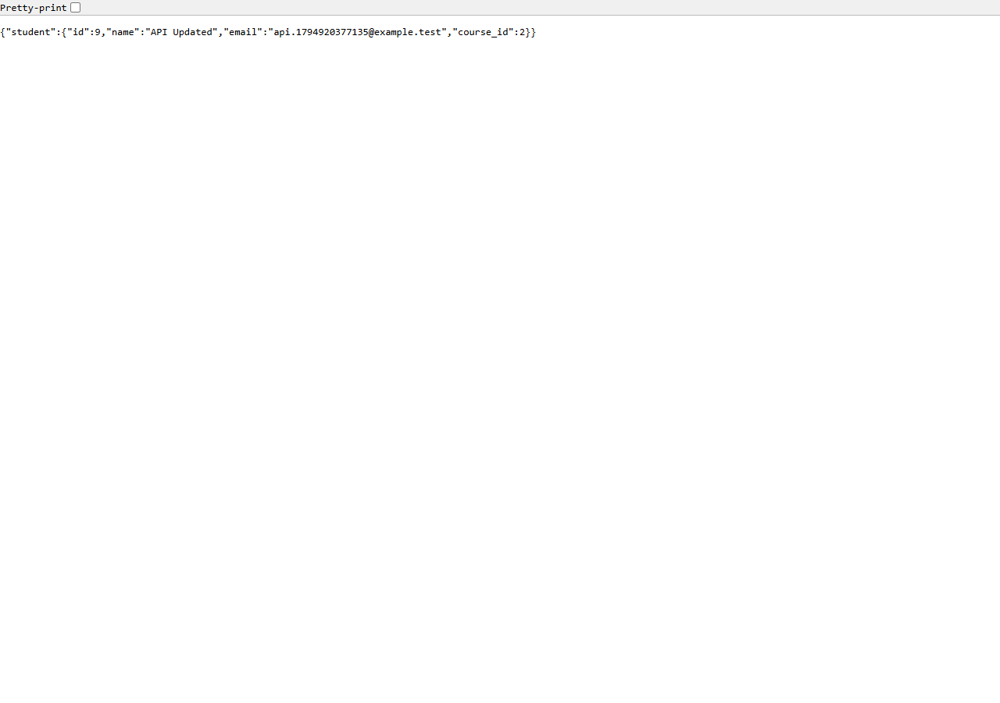

# MVC Lab Sheet 7 — Mini MVC framework and REST API

Source: `docx (15).docx`. 20 implementation tasks. Instructor: Hemendra Shankar Sharma. All seven sheets use the same runnable [PHP application](../Application/) so shared code is maintained once.

## Aim and setup

Implement and demonstrate mini mvc framework and rest api using PHP 8+ and PDO MySQL. Follow the [application setup](../Application/README.md) before running this sheet. Database scripts and synthetic seed data are included; no ERP or real student data is used.

## Task-wise implementation

| No. | Source task | Code | Behavior |
|---:|---|---|---|
| 1 | Create Framework Directory Structure | [app/](../Application/app/) | Core infrastructure is separate from application modules. |
| 2 | Develop Front Controller | [public/index.php](../Application/public/index.php) | Bootstraps requests and catches application errors. |
| 3 | Develop Router Class | [app/Core/Router.php](../Application/app/Core/Router.php) | Matches HTTP methods and parameterized paths. |
| 4 | Develop Request Class | [app/Core/Request.php](../Application/app/Core/Request.php) | Parses paths, methods and JSON/form input. |
| 5 | Develop Response Class | [app/Core/Response.php](../Application/app/Core/Response.php) | Provides JSON status responses and safe local redirects. |
| 6 | Develop BaseController | [app/Core/BaseController.php](../Application/app/Core/BaseController.php) | Supplies reusable rendering and flash redirect behavior. |
| 7 | Develop BaseModel | [app/Core/BaseModel.php](../Application/app/Core/BaseModel.php) | Supplies a PDO connection and prepared query helper. |
| 8 | Develop View Engine | [app/Core/View.php](../Application/app/Core/View.php) | Renders PHP templates with common header/footer. |
| 9 | Develop Database Connection | [app/Core/Database.php](../Application/app/Core/Database.php) | Reuses one request-local PDO connection. |
| 10 | Implement Middleware Support | [app/Core/Router.php](../Application/app/Core/Router.php) | Runs each configured middleware rule before the action. |
| 11 | Create Authentication Middleware | [app/Middleware/AuthMiddleware.php](../Application/app/Middleware/AuthMiddleware.php) | Reloads account/role and enforces login and permission rules. |
| 12 | Implement Error Handling | [public/index.php](../Application/public/index.php) | Uses meaningful HTTP status codes with HTML or JSON error output. |
| 13 | Implement GET API | [app/Controllers/ApiStudentController.php](../Application/app/Controllers/ApiStudentController.php) | Lists/paginates students or returns one student by ID. |
| 14 | Implement POST API | [app/Controllers/ApiStudentController.php](../Application/app/Controllers/ApiStudentController.php) | Validates and creates a student; returns 201 and a Location header. |
| 15 | Implement PUT API | [app/Controllers/ApiStudentController.php](../Application/app/Controllers/ApiStudentController.php) | Replaces required student fields after existence and permission checks. |
| 16 | Implement DELETE API | [app/Controllers/ApiStudentController.php](../Application/app/Controllers/ApiStudentController.php) | Admin-only removal returns JSON confirmation. |
| 17 | Return JSON Responses | [app/Core/Response.php](../Application/app/Core/Response.php) | Sets application/json and encodes structured data. |
| 18 | Test APIs using Postman | [tests/MVC.postman_collection.json](../Application/tests/MVC.postman_collection.json) | Import the supplied collection; session cookies and CSRF variables are chained between requests. |
| 19 | Integrate APIs with Student Module | [app/Models/StudentModel.php](../Application/app/Models/StudentModel.php) | HTML controllers and API controllers use the same persisted model. |
| 20 | Complete Student Management System | [tests/integration.cjs](../Application/tests/integration.cjs) | Browser and HTTP checks exercise the complete application, roles and error paths. |

## Procedure

1. Run the shared application, then import the Postman collection.
2. Set baseUrl, email and password locally; do not export credentials.
3. Run login, CSRF retrieval, GET, POST, PUT and DELETE in order.
4. Observe 201 for creation, 200 for update/delete, 404 for the deleted record.
5. Compare the API-created student with the Students HTML list before deletion.

## Request flow and wireframe

```text
Browser -> public/index.php -> Request -> Router -> middleware
        -> controller -> model/PDO -> MySQL
        -> view + header/footer OR JSON response

+---------------------------------------------------+
| Portal title | Dashboard | Modules | Profile       |
+---------------------------------------------------+
| Page heading and success/error message             |
| Form / records / API result for the current module |
| Labeled controls, validation and navigation        |
+---------------------------------------------------+
| Common footer                                     |
+---------------------------------------------------+
```

## Observed output



The screenshot was captured from the running application. See [verification results](../../VERIFICATION.md) and the machine-readable [integration report](../../verification/hemendra-results.json) for executed checks. Screenshots use demonstration accounts and synthetic records.

## Brief implementation report

This sheet's responsibilities are mapped to explicit classes and templates above. Models own persistence; controllers select the workflow; the router applies authentication and role rules before dispatch. Dynamic HTML output is escaped, state-changing requests carry CSRF tokens and database values are bound through PDO. The integrated version keeps later security improvements active while demonstrating earlier MVC concepts.

The application is a classroom implementation. A production deployment would also require HTTPS configuration, operational monitoring, backup/restore, account recovery, retention policy and a deployment-specific security review. No production-readiness certification is claimed.

## Viva questions

- Why does a cookie-authenticated REST API need CSRF protection?
- When should an API return 401, 403, 404, 409 or 422?
- How does sharing a model keep HTML and API behavior consistent?
